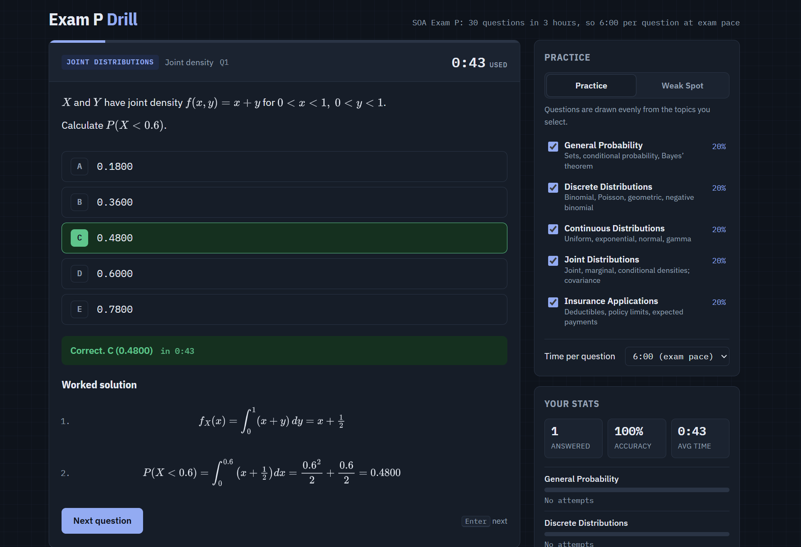

# Exam P Drill

**[▶ Try it live](https://3htan.github.io/exam-p-drill/)**: runs in your browser, nothing to install.

Unlimited, timed practice questions for the SOA Exam P (Probability). Every question is generated fresh with random numbers, answered by the code itself, and comes with a full worked solution. A "Weak Spot" mode steers practice toward the topics you miss most.



## What it does

- **23 question templates across the 5 Exam P areas:**

  | Topic | Templates |
  |---|---|
  | General probability | Inclusion–exclusion, Bayes' theorem, conditional probability, independent events |
  | Discrete distributions | Binomial, Poisson, conditional Poisson mean, geometric, negative binomial |
  | Continuous distributions | Uniform, exponential (memoryless, percentiles, median), normal, central limit theorem, gamma, variance from a density |
  | Joint distributions | Discrete joint tables (covariance, conditional mean), independent exponentials, variance of a linear combination, joint densities |
  | Insurance applications | Deductibles and limits for uniform, exponential and discrete losses; solving for a deductible |

- **Exam-style format:** five answer choices sorted in ascending order, like the real exam.
- **Exam pace timer:** 6:00 per question by default (30 questions in 3 hours), adjustable.
- **Worked solutions** typeset with MathJax after every answer.
- **Progress tracking:** accuracy and average time per topic, saved in your browser.
- **Keyboard shortcuts:** <kbd>A</kbd>–<kbd>E</kbd> to choose, <kbd>Enter</kbd> to check and to move on.

## The math and the design

### Every answer is computed, not stored

Each template draws random parameters and computes the correct answer with the same formula shown in the worked solution. For example, the negative binomial template asks for the probability that the $r$-th success happens on trial $n$:

$$P(r\text{-th success on trial } n) = \binom{n-1}{r-1} p^r (1-p)^{n-r}$$

The expected payment with an exponential loss, deductible $d$ and maximum payment $m$ uses the survival function:

$$\mathrm{E}[\text{payment}] = \int_d^{d+m} e^{-x/\theta}\,dx = \theta\left(e^{-d/\theta} - e^{-(d+m)/\theta}\right)$$

### Wrong answers come from real mistakes

Distractors are not random. Each template computes the answers that common errors produce: forgetting the binomial coefficient, using $P(A \cap B)$ instead of $P(A \mid B)$, the per-loss instead of the per-payment expectation, dropping the covariance term in $\mathrm{Var}(aX + bY)$, and so on. If too few survive the filters (probabilities stay in $[0,1]$, choices must be distinct and not too close together), nearby values fill the remaining slots.

### Weak Spot mode

Each selected topic $t$ gets a Laplace-smoothed accuracy and a sampling weight:

$$\hat a_t = \frac{c_t + 1}{n_t + 2}, \qquad w_t \propto (1 - \hat a_t)^2 + 0.02$$

where $c_t$ is correct answers and $n_t$ attempts. Squaring sharpens the focus on weak topics, the smoothing keeps a topic with one lucky answer from being ignored, and the $0.02$ floor means no topic disappears entirely.

### Normal tables

Normal questions round $z$ to two decimals and $\Phi(z)$ to four, matching how the exam's normal table is used.

## Testing

`tests/check.js` pulls the question generators out of `index.html`, builds 2,000 questions from every template (46,000 total) and checks each one: finite answer, five distinct choices with the correct one among them, probabilities in $[0, 1]$, and no broken text.

```bash
node tests/check.js          # 2,000 per template
node tests/check.js 10000    # heavier run
```

## How to run it

- **Online:** open the [live page](https://3htan.github.io/exam-p-drill/).
- **Locally:** download `index.html` and open it in any modern browser. An internet connection is needed for MathJax and the web fonts.

## About

Built by Ethan Zuniga, applied mathematics student (Pierce College → CSUN), as a study tool for SOA Exam P. Developed with AI assistance as part of coursework for the Google AI Professional Certificate. I chose the topics, reviewed the formulas and solutions, and tested the generators.

[LinkedIn](https://www.linkedin.com/in/ethan-zuniga-476017326) · MIT License
